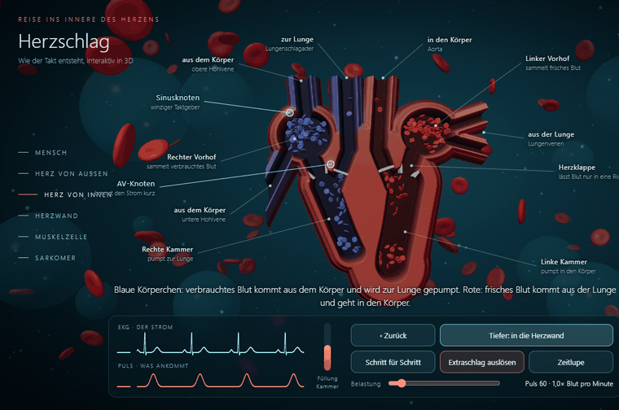

### Hi, ich bin Miriam 👋

Ich programmiere nicht – und baue trotzdem. Zusammen mit [Claude Code](https://claude.com/claude-code)
entstehen hier Dinge, die mich selbst zum Staunen bringen.

*I don't code – and I build anyway. Things that make me go "wow", made together with Claude Code.*

---

#### 🫀 [Herzschlag – Reise ins Innere des Herzens](https://herzschlag-erklaert.netlify.app)

Interaktives 3D-Erklärstück: sechs Zoom-Ebenen vom Menschen bis zum Sarkomer, EKG, Extraschlag,
Belastungs-Regler. Läuft im Browser, auch am Handy. → [ausprobieren](https://herzschlag-erklaert.netlify.app) ·
[Code](https://github.com/miriam-halimi/herzschlag-erklaert)

#### ☀️ [PV Tariff Reality Check](https://github.com/miriam-halimi/pv-tariff-reality-check)

Spart mein dynamischer Stromtarif wirklich Geld? Echte Kosten aus Live-Daten nachgerechnet und
gegen echte Rechnungen geprüft.
